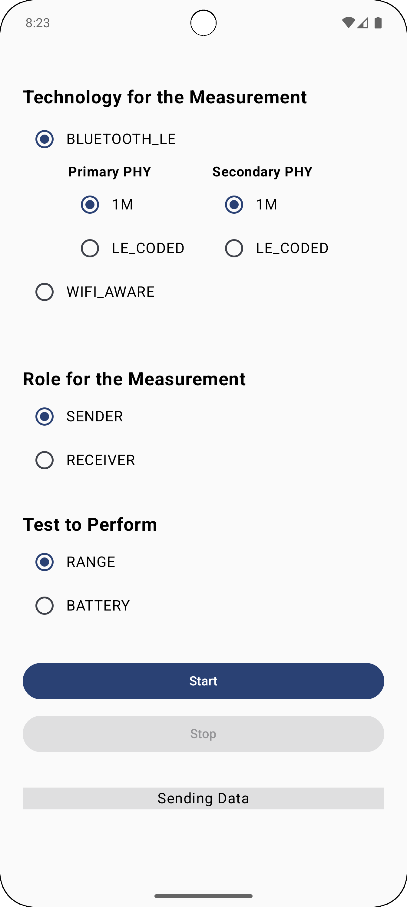
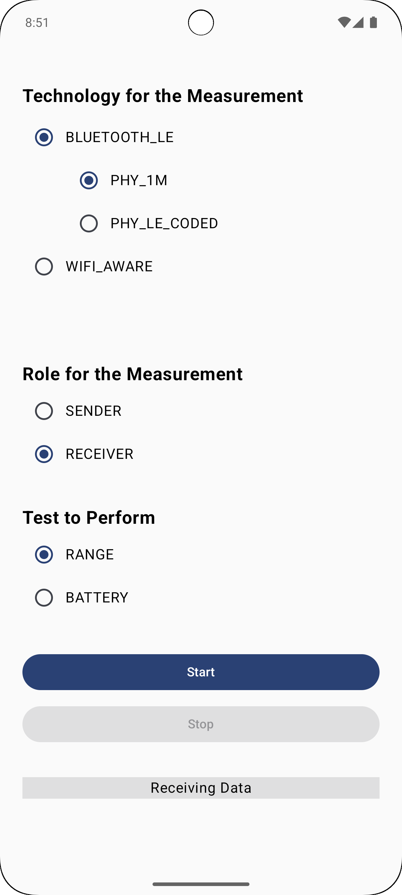

# Device-to-Device Technology Tester

This application enables the test of device-to-device (D2D) communication technologies of Android smartphones in terms of power consumption and transmission range. This application targets D2D communication technologies  for connectionless broadcast communication.

## ✨ Features
* Observation of the power consumption when performing connectionless broadcast communication
* Observation of the transmission range for connectionless broadcast
* Test of different configuration settings for the D2D communication technologies (current only supported for Bluetooth Low Energy with PHY selection)

## 🛜 Supported Communication Technologies
* Bluetooth Low Energy (Advertising)
* Wi-Fi Aware (Service Discovery)

## 📸 Screenshots
 &nbsp; &nbsp; 

## ℹ️ Operational Details
Both currently implemented test types (power consumption and transmission range) rely on a sender device broadcasting data and a receiver device scanning for the sent data.

When performing the power consumption test, the broadcast data corresponds to a randomly generated byte array simulating application data to be sent. When starting the power consumption test, the sender and receiver devices begin observing a decrease in the battery level. If the battery level decreases, the corresponding device creates a log including the new battery level, the timestamp of the decrease, and optional additional information (e.g., the used PHY when testing Bluetooth Low Energy). After the test stops, the devices create a persistent log file containing the battery level history.
\
During the transmission range test, the sender incorporates a UUID into the broadcasted data. When the sender detects a change in location, it generates a new UUID and updates the UUID in the broadcasted data. Additionally, when a new location is detected, the server generates a log including the new UUID, the new location, a timestamp, and optional additional information (e.g., the PHY used when testing Bluetooth Low Energy). Each time the receiver retrieves broadcasted data from the server, it generates a log including the UUID contained in the retrieved data, the receiver's current position, a timestamp, and optional additional information (e.g., the PHY used for scanning when testing Bluetooth Low Energy). After the test stops, each device creates a persistent log file containing the location-related logs. The UUID enables one to reference the logs of the sender and receiver. Consequently, one can determine the location of the sending device when a packet is broadcasted and the location of the receiving device when this packet is retrieved. This allows one to determine the distance between the devices, enabling the maximum transmission range to be determined.

## 🛠️ Installation & Getting Started
As the application is not packaged, [Android Studio](https://developer.android.com/studio) is required for compilation. Check out the source code, run the compilation process and deploy the applicaiotn on the devices to conduct the test with.

## 📄 License
Licensed under the MIT License, Copyright (c) 2026 Leopold Bialek
